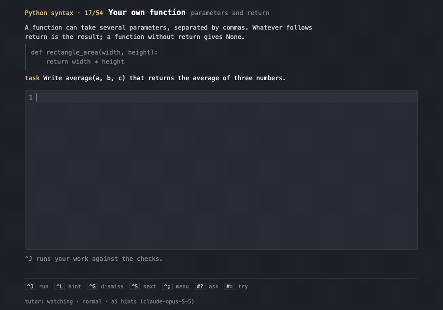
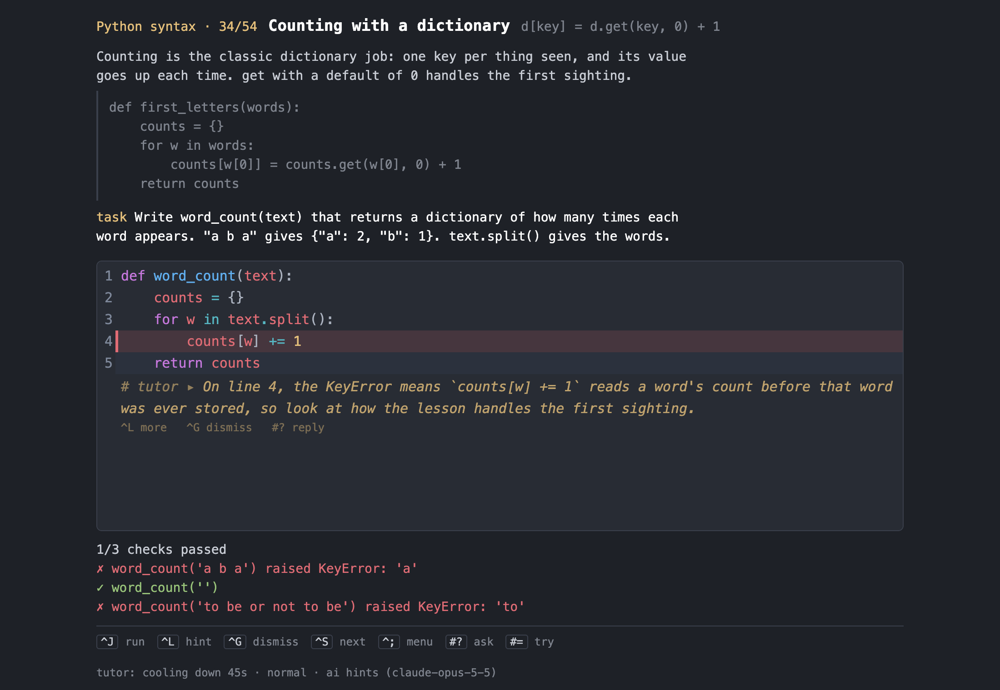
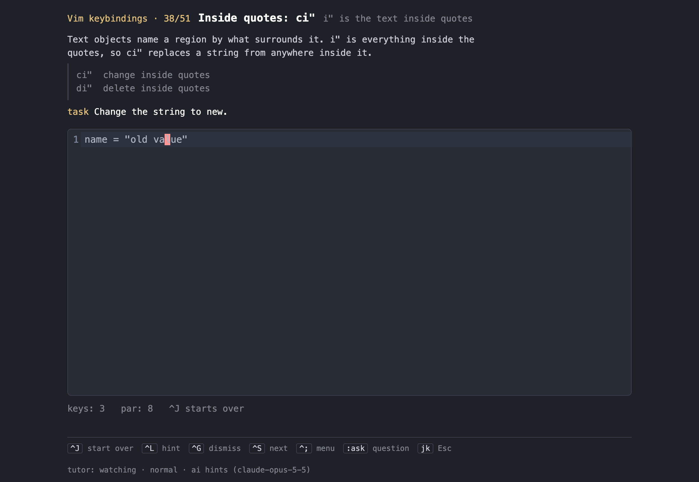
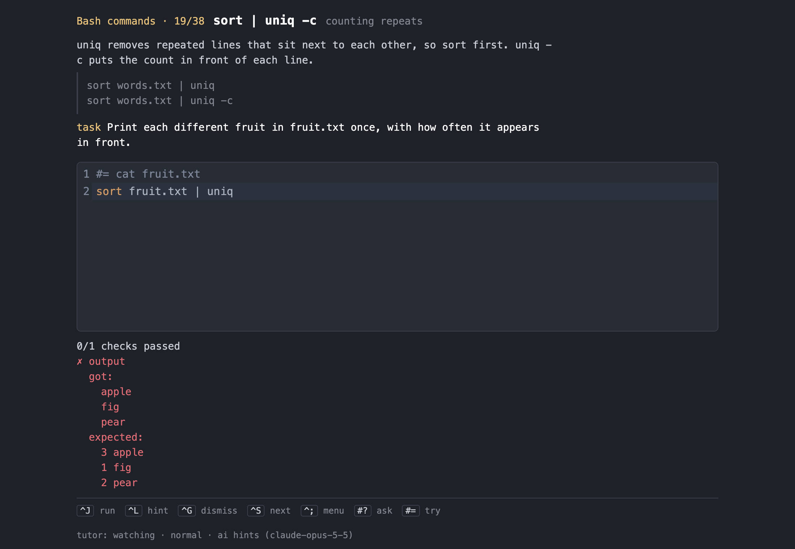
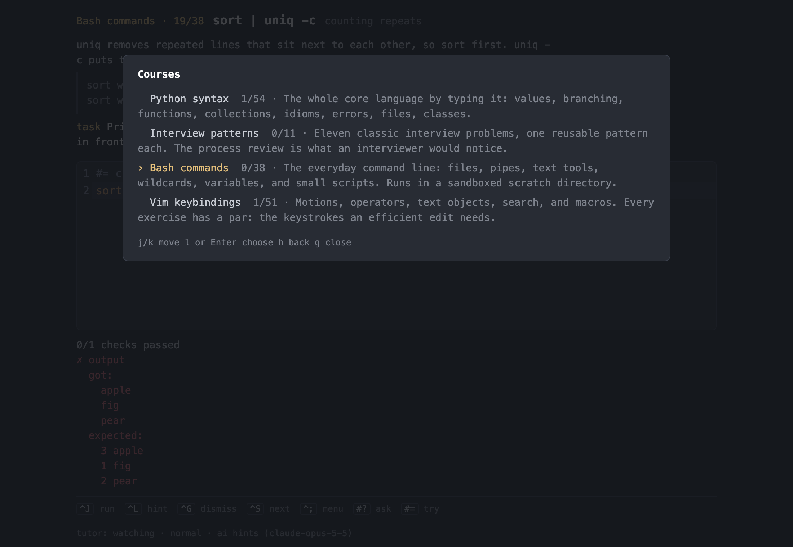

# Home Row Tutor

A keyboard-only tutor that watches how you type, not just what you end up with. You read a short lesson, type the answer, and run it without leaving the home row. The tutor stays quiet while you make progress and speaks up, inline under your cursor, when your edit history shows you are stuck.



## Courses

| Course | Tasks | Covers |
|---|---|---|
| Python syntax | 54 | print through classes, with an unaided checkpoint at the end of each section |
| Interview patterns | 11 | one classic problem per reusable pattern |
| Bash commands | 38 | files, pipes, text tools, wildcards, variables, small scripts |
| Vim keybindings | 51 | motions, operators, text objects, search, macros, each with a par keystroke count |
| Teach me… | 8 | a Python course generated on any topic you type |

## Run it

Requires Python 3.10+ and a modern browser. Built and tested on macOS.

```
git clone https://github.com/cleiderg/home-row-tutor.git
cd home-row-tutor
./tutor
```

It opens `http://127.0.0.1:8421`. Hints come from the first of these that is available:

1. the Claude API, if `ANTHROPIC_API_KEY` is set
2. the `claude` command line tool, if it is installed and logged in
3. hints written into each exercise, with no AI

## Keys

| Key | Action |
|---|---|
| `Ctrl-J` | Run your work against the checks (Vim course: start the exercise over) |
| `Ctrl-L` | Hint, or the next level of hint |
| `Ctrl-G` | Dismiss the hint |
| `Ctrl-S` | Next task (twice to skip) |
| `Ctrl-;` | Menu: courses, chattiness, Vim keys, cheat sheet, progress, Teach me |
| `#? question` + Enter | Ask the tutor |
| `#= expression` + Enter | Try an expression or shell command without affecting the task |

With Vim keys on, `jk` or `Ctrl-[` leaves insert mode and `:ask question` asks the tutor.

## How it decides to speak

Rules in the browser watch the keystroke log, so typing never waits on the network. At the default setting the tutor speaks after a 25 second pause, three delete-and-retype bursts, two runs that fail the same way, or (in Vim) far more keystrokes than the exercise needs. With AI on, it also checks now and then whether your approach can work at all.

Hints wait for a gap in your typing and climb a ladder: a nudge, then a guiding question, then an example on a different problem. You cannot click through the ladder; each step up needs an attempt.



## What makes it a tutor and not an autocomplete

- **It never writes your answer.** Every AI hint is checked against the reference solution before you see it.
- **It reviews the process.** When you solve a task it tells you where the time went and the pattern to remember.
- **It brings back what you struggled with.** Tasks that needed hints return after 1, 3, 7, 16, then 35 days, with the lesson hidden.
- **It tests you without help.** Checkpoints have no lesson and a silent tutor, so you can see what has stuck.
- **It collects your mistakes** into a cheat sheet you can open from the menu.

| Vim: judged on keystrokes | Bash: checked on output and files |
|---|---|
|  |  |



## Safety

On macOS, the Python and shell commands you type run in a sandbox with no network access and can only write inside a temporary directory. On other systems they run unconfined. The server listens on localhost only.

## More

- `python3 server.py --selftest` checks every Python and Bash reference solution.
- `python3 server.py --report` summarises the saved session logs per task.
- `python3 server.py --export dist` writes a static copy that runs Python in the browser, with no server. It has no Bash course and no AI hints.
- `PRD.md` describes the product and `SPEC.md` the design, including how to add a course.
